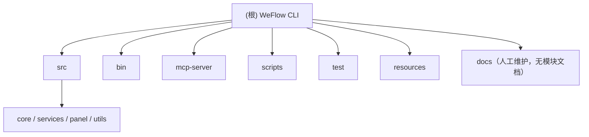

# WeFlow CLI 快速维护入口

先阅读：

1. `AGENTS.md`：仓库级约束。
2. `docs/PROJECT_STATE.md`：当前能力、限制和验证状态。
3. `docs/DECISIONS.md`：不可随意推翻的安全与架构取舍。
4. `OPERATIONS.md`：用户操作和排障流程。
5. `ARCHITECTURE.md`：模块边界和数据流。
6. `docs/EXTENDING.md`：要给这个项目加功能（工具/配置键/命令/MCP 工具/Python 脚本）时改哪几处，
   以及**哪条测试会拦你**——包括"漏了会静默失败、没有任何东西会红"的那几处。

## 常用开发命令

```powershell
npm install
npm run build
npm test
npm run dev -- <command>
```

日报无 AI 运行：

```powershell
npm run dev -- daily --no-ai
npm run dev -- daily-server --date YYYY-MM-DD --open
```

## 维护原则

- 仅处理用户本人或明确获授权的数据。
- 不把数据库、密钥、token、账号标识、聊天内容、导出文件或真实路径放进代码、文档、Issue、PR 或测试夹具。
- 不把 npm 发布包当作 GitHub 源码的实时镜像；先确认版本和提交。
- 变更功能、限制或验证状态时同步 `docs/PROJECT_STATE.md`；影响安全、数据流或兼容性时追加 `docs/DECISIONS.md`。
- 发送、助手、MCP 和云端 AI 都要保留显式权限边界；不实现远程静默控制或非官方协议绕过。

## 项目索引（AI 上下文）

### 项目愿景

本地优先的微信数据工具：公众号日报、聊天导出、知识库（Vault / 概念页）、可选 AI 助手、MCP Server 和本机悬浮球面板。
面向用户本人有权访问的数据，详见 `ARCHITECTURE.md` 的"定位"。

### 架构总览

入口有三条：CLI（`bin/weflow-cli.ts`）、MCP（`mcp-server/index.ts`）、本机面板守护进程（`src/panel/`）。
三者共用 `src/services/` 业务层，其中 `src/services/assistantTools.ts` 是助手与 MCP 共用的工具表。
耗时的数据处理与知识卡生成由 `scripts/` 下的 Python 工作流完成，经 `src/services/pythonBridge.ts` 调用。

### 模块结构图



### 模块索引

| 模块 | 路径 | 职责 | 模块文档 |
| --- | --- | --- | --- |
| CLI 入口 | `bin/` | Commander 命令、参数校验、交互式菜单 | [bin/CLAUDE.md](bin/CLAUDE.md) |
| 核心业务层 | `src/` | core（数据库/密钥/路径）、services（业务与助手）、panel（本机面板）、utils | [src/CLAUDE.md](src/CLAUDE.md) |
| MCP 服务 | `mcp-server/` | stdio 与回环 HTTP 两种传输的 MCP 服务端 | [mcp-server/CLAUDE.md](mcp-server/CLAUDE.md) |
| Python 工作流 | `scripts/` | NT 数据读取、日报、知识卡、概念页、图谱、RAG | [scripts/CLAUDE.md](scripts/CLAUDE.md) |
| 测试 | `test/` | node:test 与 Python unittest 回归测试 | [test/CLAUDE.md](test/CLAUDE.md) |
| 随包资源 | `resources/` | 面板应用、吉祥物、原生 DLL、图谱页面库 | [resources/CLAUDE.md](resources/CLAUDE.md) |
| 文档 | `docs/` 与根目录 `*.md` | 人工维护，不生成模块级 CLAUDE.md | 见本文件顶部阅读清单 |

### 运行与开发

见上文"常用开发命令"。模块级的入口与脚本信息见各模块文档。

### 测试策略

- `npm test` 运行 `test/**/*.test.ts`（node:test + tsx）。Python 测试在 `test/*_test.py`，用 `python -m unittest discover -s test -p '*_test.py'` 运行。
- 测试文件总数与 `scripts/`、`bin/` 的计数写在 `ARCHITECTURE.md` 的"代码边界"表里，由 `test/architecture-counts.test.ts` 从源码钉住——改数字不用手动同步，跑测试会告诉你。
- "哪条测试会拦你"的完整对照表见 `docs/EXTENDING.md` 的"What will catch you"一节，本文件不重复。

### 编码规范

- 注释与文档使用中文，与现有代码一致。
- 测试夹具使用合成数据与占位符（`联系人A`、`示例群`、`YOUR_API_KEY`、`YYYY-MM-DD`）。
- 新增命令需要 `--json` 模式；破坏性操作采用 `--dry-run` 预览后 `--yes` 确认的两段式流程。详见 `docs/EXTENDING.md` Recipe C。

### AI 使用指引

- 修改前先读本文件列出的五份文档，再读对应模块的 `CLAUDE.md`。
- 不要读取 `.env`、`resources/key/`、`resources/wcdb/`、`output/` 下的内容；示例路径用占位符。
- 加功能的步骤见 `docs/EXTENDING.md`，不要凭印象只改其中一处。

## 变更记录 (Changelog)

- 2026-10-15：由 `/init-project` 追加"项目索引"章节（模块结构图、模块索引、各栏目）并生成各模块 `CLAUDE.md`。上方人工维护内容未改动。
- 2026-10-30：随上游 v1.21.4 同步（本文件的"项目索引"章节与各模块 `CLAUDE.md` 一并移植到新版基线）。
